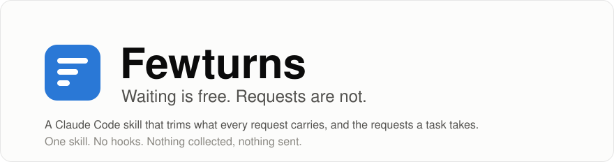
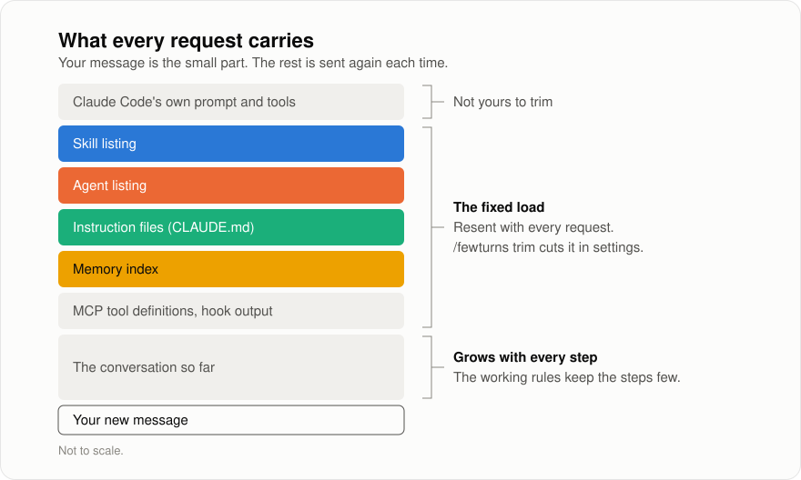
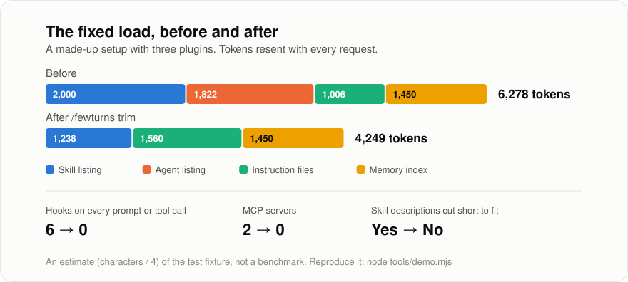
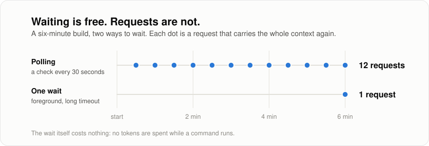

<p align="center">
  <picture>
    <source media="(prefers-color-scheme: dark)" srcset="assets/hero-dark.svg">
    
  </picture>
</p>

<p align="center">
  <a href="https://github.com/makavli/fewturns/actions/workflows/test.yml"></a>
  <a href="https://github.com/makavli/fewturns/releases/latest"></a>
  <a href="LICENSE"></a>
  
  
  
</p>

<p align="center">
  <a href="#install">Install</a> ·
  <a href="#use">Use</a> ·
  <a href="#the-working-rules">The rules</a> ·
  <a href="#what-deserves-a-look">Trust</a> ·
  <a href="#collects-nothing">Privacy</a> ·
  <a href="#limits">Limits</a> ·
  <a href="#thanks">Thanks</a>
</p>

---

Every plugin, skill, agent, hook and connector you add to Claude Code rides along on **every request**, whether or not that request uses it. Every poll of a build that is still running is one more request carrying all of it again.

Fewturns is one skill that deals with both. It weighs what your requests carry, trims it in your settings with your yes to each change, and leaves a short block of working rules that make a task take fewer requests. On the way it names what you installed that deserves a second look: a hook that downloads code and runs it, a server that changes under you, a setting that sends your requests somewhere else.

New to Claude Code? Install it, type `/fewturns` and answer at most three questions. It is free, it needs no account and no key, and every change waits for your yes.

## What every request carries

<p align="center">
  <picture>
    <source media="(prefers-color-scheme: dark)" srcset="assets/request-dark.svg">
    
  </picture>
</p>

The part in colour is yours. Most of it arrived one install at a time and nobody ever looked at the total.

## Before and after

<p align="center">
  <picture>
    <source media="(prefers-color-scheme: dark)" srcset="assets/before-after-dark.svg">
    
  </picture>
</p>

This is the setup the tests use: three plugins, a few personal skills, eight synced ones. Its fixed load goes from about **6,278** to about **4,249** tokens on every request, its hooks go, and so do both lines of its TRUST section. Its skill descriptions stop being cut short. The "after" side counts the working rules Fewturns installs: they cost a little on every request, to save whole requests.

It is an estimate of a made-up setup, not a benchmark, and your numbers will differ. Run `node tools/demo.mjs` to reproduce it, and `/fewturns` to see your own.

<details>
<summary>The audit's own output for the "before" side</summary>

```text
FEWTURNS AUDIT - what every request carries (read-only: nothing sent, nothing written)

FIXED LOAD, resent with every request                     chars  ~ tokens
  Skill listing      67 skills, cap 1,536 per description     8,000     2,000
  Agent listing      18 agents                                7,287     1,822
  Instruction files  2 CLAUDE.md files                        4,025     1,006
  Memory index       60 lines                                 5,801     1,450
  Total you can trim                                         25,113     6,278
  Not counted: Claude Code's own prompt, tools and bundled skills; MCP tool definitions (2 servers); what hooks print.
  ! The skill listing is 43,976 chars, over its budget of 8,000: descriptions are cut short to fit.
  (Budget for a 200,000-token context window; pass --window 1000000 for a 1M window.)

SOURCES, heaviest first (chars before the budget)
  plugin kitchen-sink@market: 48 skills, 14 agents, 5 hooks, 2 MCP servers - 37,874 chars
  synced from claude.ai: 8 skills - 7,295 chars
  plugin lean-dev@market: 6 skills - 2,796 chars
  plugin design-kit@market: 1 skill, 4 agents, 2 hooks - 2,485 chars
  personal (~/.claude): 4 skills - 813 chars

HOOKS THAT RUN ON EVERY PROMPT OR TOOL CALL
  PreToolUse: 2 (plugin kitchen-sink@market)
  PostToolUse: 2 (plugin kitchen-sink@market, plugin design-kit@market)
  UserPromptSubmit: 1 (plugin kitchen-sink@market)
  Stop: 1 (plugin design-kit@market)

HOOKS THAT RUN AT SESSION START (what they print is resent with every request)
  SessionStart: 1 (plugin kitchen-sink@market)

TRUST - worth a look before you rely on it (a reason to read, not a verdict)
  ! plugin kitchen-sink@market, hooks/setup.sh: downloads code from the internet and runs it
  ! plugin kitchen-sink@market, MCP server server-1: runs the newest version of some-mcp-server at every start
  Plugins in use update from: market (github example/market)
```

</details>

## Waiting is free

<p align="center">
  <picture>
    <source media="(prefers-color-scheme: dark)" srcset="assets/waiting-dark.svg">
    
  </picture>
</p>

**Size is not the bill.** What a request repeats from the one before is read from a cache, at a fraction of the price, so a large context you need costs little while it stays the same. The bill grows with the number of requests, with every cache miss (a change early in the context, a switch of model, a pause longer than the cache lasts), with the output, and with the size of the model doing the work. That is why the fixed load worth cutting is the part you never use, and why the rules go after requests and hand small jobs to small models.

A trimmed request is still a request. The second half of Fewturns is a block of ten working rules, written into your `CLAUDE.md`, that changes how the agent spends them. [Read the rules](#the-working-rules).

## Install

**Claude Code**, as two separate prompts:

```text
/plugin marketplace add makavli/fewturns
```

```text
/plugin install fewturns@fewturns
```

**With the skills CLI** (Claude Code and other agents that read skills):

```bash
npx skills add makavli/fewturns -g
```

**By hand:** copy the [`skills/fewturns`](skills/fewturns) folder into `~/.claude/skills/`.

**What you get is a release.** Every merge into `main` is published as a release, so `main` and the latest release are always the same thing, and each route above installs it. To stay on one version, name it:

```text
/plugin marketplace add makavli/fewturns@v1.2.1
```

**Any other agent:** the rules are plain Markdown. Copy the block from [`skills/fewturns/RULES.md`](skills/fewturns/RULES.md) into your `AGENTS.md`.

The audit needs Node 20 or later and nothing else. Without Node the skill still works; it reads your settings files instead of measuring.

## Use

| Command | What it does |
| --- | --- |
| `/fewturns` | **Setup**, the guided path. Runs the audit, says in five plain lines what it found, takes any TRUST line first, then asks at most three questions and applies only your answers. |
| `/fewturns audit` | Weighs the fixed load, lists the heaviest sources, the hooks and what deserves a look, and shows which levers are open. Changes nothing. |
| `/fewturns trust` | Goes through each TRUST line: what it does, when it runs, what it can reach, and whether to keep it. Removes only on your yes. |
| `/fewturns trim` | Walks through the open levers: what leaves each request, what you give up, the exact edit. Backs up each settings file first and applies only what you accept. |
| `/fewturns rules` | Writes the working rules into your `CLAUDE.md` (every project or this one), between two markers. |
| `/fewturns check` | In a fresh session, confirms the settings took: compares your files with what the session really loaded, and says whether your rules are this version's. |
| `/fewturns undo` | Sets the settings Fewturns changed back to their backup values, or removes the rules block, a stub or the helpers. |

**Run it once, then switch it off if you like.** What Fewturns does lives in your settings and your `CLAUDE.md`, not in the plugin. After setup, the plugin can be disabled and everything keeps working; enable it again for a `check` or a `trust` after you install something new.

### The levers

`/fewturns trim` knows these, with the trade-off of each. The full reference, with what each one gives up, is [`LEVERS.md`](skills/fewturns/LEVERS.md).

| Lever | What it trims |
| --- | --- |
| Plugins you don't need in every session | Their skills, agents, hooks and MCP servers. Usually the largest item. |
| The on-demand stub | Keeps a disabled plugin's main skill starting by itself, for the price of one description. [How](skills/fewturns/STUB.md). |
| Skills that cannot work on this machine | Their lines in the listing. |
| A cap on description length | The tail of every long skill description. |
| claude.ai connectors and unused MCP servers | Their tool definitions. |
| Hooks on every prompt or tool call | A process per call, and the text it adds. |
| Background model calls | Prompt suggestions, precomputed compaction, the session recap. |
| Effort, the helper model, the compaction window | The cost of each request and of late requests in a long session. |
| Lean helpers | Four helper files that name a small model and only the tools their job needs, so each turn a helper takes costs less. [How](skills/fewturns/HELPERS.md). |
| A lean `CLAUDE.md` and memory index | Lines that restate the code, status that grew inside an index. |

## The working rules

This is the block `/fewturns rules` installs, in full. It is short on purpose: it is loaded in every session, so it pays its own way.

> **Fewturns: waiting is free, requests are not**
>
> - **One wait.** Finish every edit, then build and test in one command. Under ten minutes, run it in the foreground with a long timeout: the wait costs nothing. Longer, run it in the background, say so in one line and end the turn; the harness calls back when it exits. Each poll, sleep or wake-up is a paid request. If the user writes while a job runs, check it once and carry on.
> - **Tails.** Read the end of an output or its error lines (`grep -E "error|FAIL|passed"`), and only the part of a file the task needs. Tile many pictures (video frames, screenshots) into one contact sheet first (ffmpeg's `tile` filter); open a single one only where the sheet is not enough.
> - **Batch.** Send independent reads, searches and commands in one message. Report once, briefly.
> - **Clean up.** Stop each background task, monitor or scheduled job as soon as its news has arrived. Schedule a check only on request: one job, at the pace the watched thing changes, deleting itself when done.
> - **A tool beats a one-liner.** A check worth running twice becomes a small script in the repository, run as one command.
> - **Helpers that pay.** Hand a subagent a bounded job that would flood this context: a wide search, a review of a finished diff, an audit. On every call, name the smallest model that can do the job: a built-in helper may otherwise run on this session's model. As few helpers as the job needs, one shared brief, a short report, one writer per file. A small job stays inline, and so does work that needs the machine to itself (a build, an editor, a render).
> - **Skills by need.** Load and run the skill the task calls for, never apply one from memory; name the ones used in one line.
> - **Local first.** Test on this machine; let CI run to publish.
> - **Lean index.** Always-loaded files (this one, the memory index) hold short pointers; status and history live in the file a pointer names. A handoff page read at every start holds the state now: each update rewrites it and drops what is no longer true.
> - **Cost shapes the plan.** It is a reason to take fewer steps, never to stop: name a large cost once, then carry on.

### Your half

The agent can only save the requests it makes. These are yours:

- **One message, everything in it.** Test, note all you noticed, send it once. Five small corrections are five rounds of the whole context.
- **Raise effort for the hard problem, not for the day.** `/effort high` when you need it; the default stays lower.
- **Mind the pause in the middle of a task.** The context is cached between requests for about an hour on a subscription and five minutes on an API key. After a longer break, the first message back reads everything again at full price.

## What deserves a look

A skill is text you can read before you install it. What runs is another matter: a hook runs commands on your machine, an MCP server runs a program or passes what it gets to another host, and one setting can route every request through somebody else's server. The audit reads all of that, runs none of it, and lists what deserves a second look in its TRUST section (the example above shows two lines). It reads the plugins in use and your settings files: their hooks, the scripts those hooks name, their MCP servers and the settings themselves. It looks for:

- code downloaded from the internet and run, or hidden text decoded to run;
- your keys and passwords: SSH keys, cloud and git credentials, your Claude key;
- something set to run at login or on a schedule, or a delete aimed at your home folder;
- an MCP server that runs the newest version of a package at every start, or that connects to another host;
- a setting that sends your requests to a server that is not Anthropic's, hands over your key, or lets Claude run every command without asking;
- a project you cloned that grants itself hooks or every shell command;
- a hook command or script too long to check by pattern.

Its last line says where each plugin in use updates from: whoever controls that repository can change what runs on your machine at the next update.

`/fewturns trust` takes each line in turn and removes nothing without your yes. [TRUST.md](skills/fewturns/TRUST.md) says what each line means and how to remove what you do not want.

**A line is a reason to read, not a verdict:** a guard that keeps the agent away from your keys names them too. **An empty section is not a guarantee:** the check reads patterns, and code can hide. Three habits do more than any check:

- Install from a public repository whose code you can read, and weigh each install with `/fewturns`.
- Be wary of a skill that asks for your Claude login, your API key or a payment before it works. Fewturns asks for none of them.
- Fewer is better. Every plugin adds to every request, and every hook runs on your machine.

## Collects nothing

Fewturns has no telemetry, no ledger, no account and no network code, and it never will have. To be exact about what it does on your machine:

- **It reads** your Claude Code settings files, the lists of installed plugins and of their marketplaces, the headers of your skills and agents, the hook and MCP configuration (plugin files, `.mcp.json` and the server list in `~/.claude.json`), the scripts your hooks name, your `CLAUDE.md` files (their size, and whether they hold this version's rules) and your memory index. All of it locally, and it runs none of it. For `/fewturns trust`, the agent also asks your shell for one variable the script cannot read, `ANTHROPIC_BASE_URL`.
- **It prints** one report to your terminal. The audit script writes no file, opens no connection and starts no process. A test fails the build if that ever changes: [`tests/audit.test.mjs`](tests/audit.test.mjs) allows the script four read-only functions and nothing else.
- **It changes** only what you approve, as ordinary edits you can read: settings keys, one block in `CLAUDE.md`, a stub skill, helper files. Each settings file is backed up beside itself first.
- **It ships no hooks**, so nothing of Fewturns's runs unless you call it.

## Limits

- **Estimates, not measurements.** Token figures are characters divided by four. They rank your sources well and price them roughly.
- **Not everything can be counted from files.** Claude Code's own system prompt, its built-in tools and skills, the tool definitions of MCP servers and the text hooks print are outside what the audit can see. It says so in every report. Instruction files pulled in by an `@import` are not counted either, so that line is a lower bound.
- **The trust check reads patterns.** It reads the plugins in use, since a disabled one runs nothing. It finds the usual shapes of a risky hook, server or setting, not every way code can hide, and it cannot see what a script downloads or what a server does once it runs. An empty TRUST section is a first look, not a clean bill of health.
- **Settings move.** The levers were checked against Claude Code 2.1.322. A key your version does not know is ignored silently, which is why `/fewturns check` compares the files with what a fresh session actually loaded.
- **No benchmark.** Nothing here claims a percentage for your setup. The one before-and-after figure is a made-up fixture you can rebuild yourself.
- **Every lever has a price.** A disabled plugin is gone until you bring it back; a lower effort thinks less. Fewturns names the price and you decide.

## Development

```bash
git clone https://github.com/makavli/fewturns.git
cd fewturns
npm run check     # the pictures are current, then the tests
npm run demo      # the before-and-after audit of the test fixture
```

No dependencies to install. The layout:

```text
skills/fewturns/SKILL.md           the skill: setup, audit, trust, trim, rules, check, undo
skills/fewturns/LEVERS.md          every lever, its edit and its price
skills/fewturns/HELPERS.md         four lean helpers, and why they pay
skills/fewturns/RULES.md           the working rules block
skills/fewturns/STUB.md            the on-demand stub for a disabled plugin
skills/fewturns/TRUST.md           what each TRUST line means, and how to remove it
skills/fewturns/scripts/audit.mjs  the read-only audit
tests/                           the audit's tests and the repository's own checks
tools/                           the demo, the picture generator, the version and release helpers
```

Contributions are welcome, new levers and trust patterns most of all: see [CONTRIBUTING.md](CONTRIBUTING.md).

## Thanks

Fewturns exists because of the people who build skills in the open and give them away. It was shaped by using their work every day, and by learning what each one costs and what it is worth:

- [Ponytail](https://github.com/DietrichGebert/ponytail) by Dietrich Gebert, for the proof that one honest prompt can change how an agent works, and for a repository worth studying.
- [Impeccable](https://github.com/pbakaus/impeccable) by Paul Bakaus, the reason the on-demand stub exists: too good to give up, and worth loading only when needed.
- [Matt Pocock's skills](https://github.com/mattpocock/skills), whose guide to writing for agents this skill was written with.
- [Anatomy](https://github.com/wheresryan22/anatomy), [Hallmark](https://github.com/nutlope/hallmark), Cloudflare's [security-audit skill](https://github.com/cloudflare/security-audit-skill) and [ECC](https://github.com/affaan-m/ECC), for showing how much a single skill can carry.

None of them is affiliated with Fewturns or endorses it. Install them. Then weigh them.

## License

[MIT](LICENSE).
